## Juni 1992

<table class="month">
<tr><th>Mo</th><th>Di</th><th>Mi</th><th>Do</th><th>Fr</th><th class="h2">Sa</th><th class="h1">So</th></tr>
<tr><td>1</td><td>2</td><td>3</td><td>4</td><td>5</td><td class="h2">6</td><td class="h1">7</td></tr>
<tr><td class="h1">8</td><td>9</td><td>10</td><td>11</td><td>12</td><td class="h2">13</td><td class="h1">14</td></tr>
<tr><td>15</td><td>16</td><td>17</td><td class="h1">18</td><td>19</td><td class="h2">20</td><td class="h1">21</td></tr>
<tr><td>22</td><td>23</td><td>24</td><td>25</td><td>26</td><td class="h2">27</td><td class="h1">28</td></tr>
<tr><td>29</td><td>30</td><td></td><td></td><td></td><td></td><td></td></tr>
</table>

Der Juni beginnt mit einem Bild (vermutlich aus dem Kindergarten), auch wenn ich nicht sagen kann, was genau es darstellen soll, oder unter welchen genauen Umständen es entstanden ist (denn in allen anderen Fällen sind die Kindergartenwerke undatiert, sodass dieses hier irgendwie besonders sein muss).

{:.image}
> [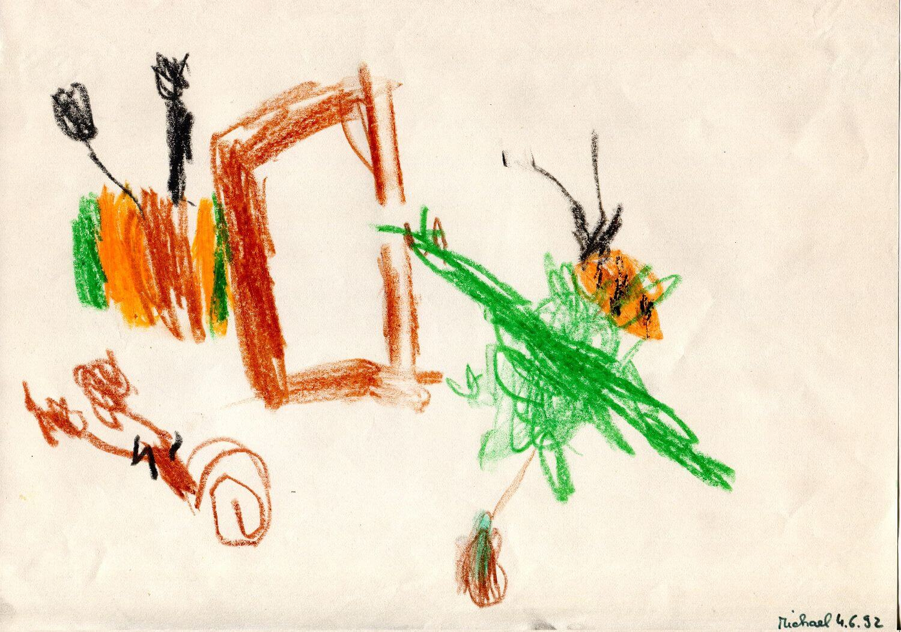{: width="1500" height="1054"}<!--[-->](../files/1992-06/bild.jpg)

Ebenfalls im Kindergarten basteln wir einen Schmetterling mit Notizzetteln.

{:.gallery}
* [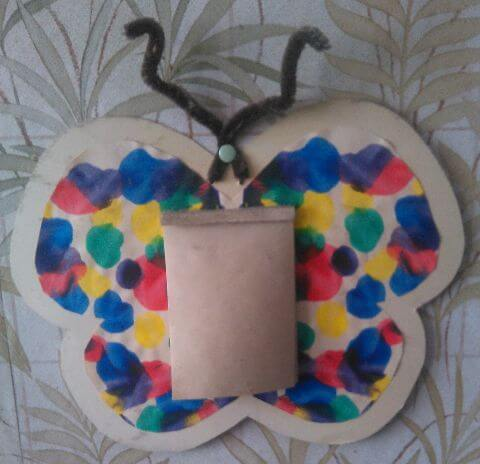{: width="480" height="464"}<!--[-->](../files/1992-06/schmetterling.jpg)

Die bunten Flügel gestalten wir, indem wir ein Papier mit Farbe beklecksen und dann zusammenfalten. Verstärkt wird der Schmetterling durch Karton, die Fühler sind aus Pfeifenreinigern.

Auch daheim bastle ich, aus dem <i>Marc-&-Penny</i>-Heft stammt dieser Pirat mit Schatztruhe.

{:.gallery}
* [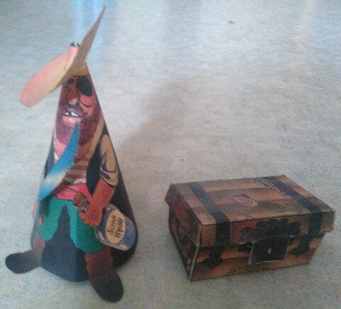{: width="480" height="435"}<!--[-->](../files/1992-06/pirat.jpg)

Das Kindergarten-Sommerfest am 27. Juni dreht sich um die Raupe Nimmersatt.

{:.gallery}
* [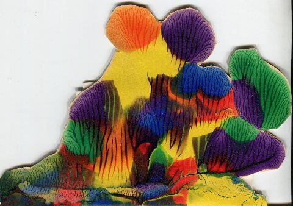{: width="480" height="338"}<!--[-->](../files/1992-06/einladung.jpg)

  Einladung
* [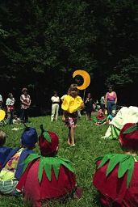{: width="171" height="256"}<!--[-->](../files/1992-06/sommerfest1.jpg)
* [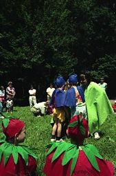{: width="169" height="256"}<!--[-->](../files/1992-06/sommerfest2.jpg)
* [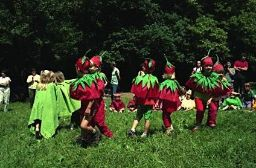{: width="256" height="168"}<!--[-->](../files/1992-06/sommerfest3.jpg)
* [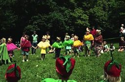{: width="256" height="168"}<!--[-->](../files/1992-06/sommerfest4.jpg)
* [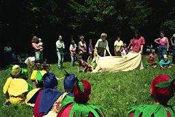{: width="256" height="171"}<!--[-->](../files/1992-06/sommerfest5.jpg)
* [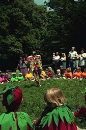{: width="169" height="256"}<!--[-->](../files/1992-06/sommerfest6.jpg)
* [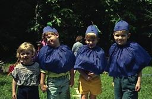{: width="256" height="168"}<!--[-->](../files/1992-06/sommerfest7.jpg)
* [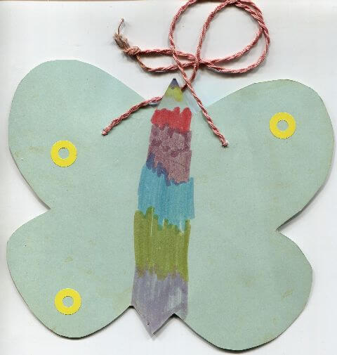{: width="480" height="505"}<!--[-->](../files/1992-06/laufkarte.jpg)

Die Einladung steckt in einem Schmetterling, ähnlich gestaltet wie der mit den Notizzetteln. Wir führen die Geschichte als Theaterstück auf, ich spiele eine der drei Pflaumen, Kim und Benjamin (auf dem letzten Foto neben ihm seine Cousine, die zu Besuch ist) die beiden anderen. Wie im Vorjahr gibt es wieder verschiedene Spiele an mehreren Stationen, diesmal wird der Fortschritt natürlich auf einem Schmetterling festgehalten. Ich bin etwas enttäuscht, dass ich einen Schmetterling mit einem so unnatürlich bunten Körper bekomme, aber das Kind, das den von mir gestalteten Schmetterling bekommt, ist sicher auch nicht erfreut über das langweilige Braun. Offenbar spielt das Wetter nicht so ganz mit, denn ein Klebepunkt auf dem Schmetterling fehlt mir noch.