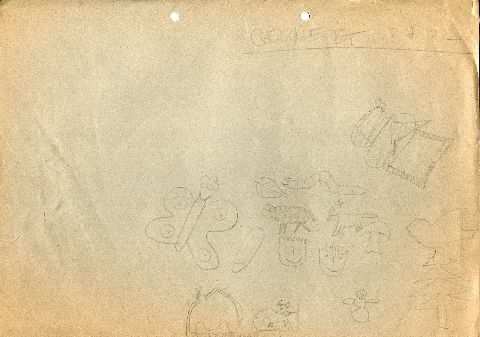
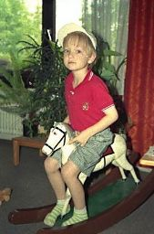
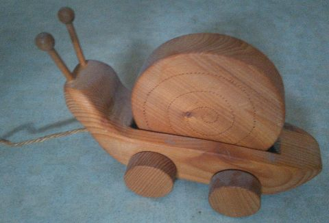
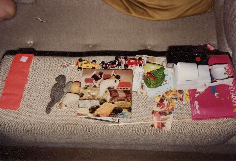
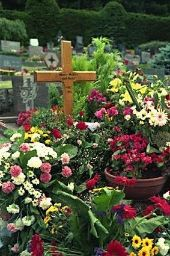
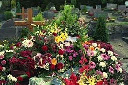
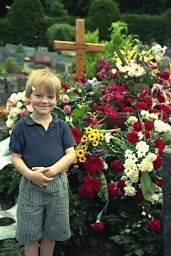
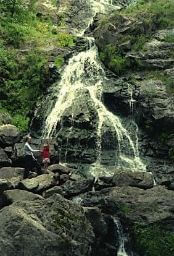
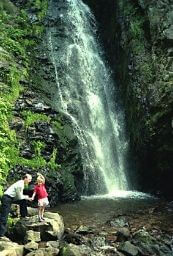
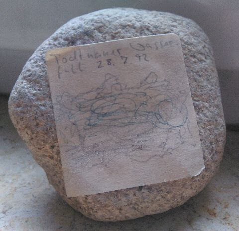

## Juli 1992

<table class="month">
<tr><th>Mo</th><th>Di</th><th>Mi</th><th>Do</th><th>Fr</th><th class="h2">Sa</th><th class="h1">So</th></tr>
<tr><td></td><td></td><td>1</td><td>2</td><td>3</td><td class="h2">4</td><td class="h1">5</td></tr>
<tr><td>6</td><td>7</td><td>8</td><td>9</td><td>10</td><td class="h2">11</td><td class="h1">12</td></tr>
<tr><td>13</td><td>14</td><td>15</td><td>16</td><td>17</td><td class="h2">18</td><td class="h1">19</td></tr>
<tr><td>20</td><td>21</td><td>22</td><td>23</td><td>24</td><td class="h2">25</td><td class="h1">26</td></tr>
<tr><td>27</td><td>28</td><td>29</td><td>30</td><td>31</td><td></td><td></td></tr>
</table>

Der Monat Juli beginnt damit, dass ich aus Knete ein paar Figuren forme, die mir so sehr gefallen, dass meine Mama sie für mich aufzeichnet um sie als Erinnerung zu bewahren. Alte Schokoladen-Adventskalender kann man übrigens beim Kneten ganz ausgezeichnet zum Gestalten verwenden, zumal zu dieser Zeit deren Motive nicht unbedingt alle weihnachtlich sind.

{:.gallery}
* [{: width="480" height="337"}<!--[-->](../files/1992-07/knete.jpg)

Für mein Schaukelpferd werde ich langsam zu groß. Am Rand des Fotos zu erahnen und auf der späteren Aufnahme zu sehen ist mal wieder ein Spielzeug, das ich auch schon sehr lange besitze: eine Schnecke aus Holz. Das Schneckenhaus ist eine Scheibe, die sich dreht, wenn man die Schnecke hinter sich herzieht.

{:.gallery}
* [{: width="169" height="256"}<!--[-->](../files/1992-07/schaukelpferd.jpg)
* [{: width="480" height="326"}<!--[-->](../files/1992-07/schnecke.jpg)

Außerdem gibt es ein Foto mit etlichen Dingen, die mir gefallen.

{:.gallery}
* [{: width="480" height="328"}<!--[-->](../files/1992-07/dinge.jpg)

Ein echtes Wimmelbild (am besten im Vollformat zu betrachten) mit einigen neuen Dingen, aber auch solchen, die ich schon früher gezeigt oder erwähnt habe: Da sind die Manschette aus meinem [Spielzeug-Arztkoffer](1992-04-01-a.md), die Rennautos aus dem [Transporter](1992-03-01-a.md), ein paar gestrickte [Tiere](1991-07-01-a.md) samt dem Heft aus der <i>Brunnen</i>-Reihe, aus dem meine Mama die Anleitung hatte, und zwei [Benjamin-Blümchen-Kassetten](1992-01-01-a.md), aber auch ein neues Kinderüberraschungsei-Spielzeug, ein Stopfei, ein alter Fotoapparat, ein Bagger aus Papier, ein Werbefähnchen und manches mehr.

Das Leben meiner Großmutter neigt sich dem Ende zu. Wir besuchen sie noch ein letztes Mal, auch die Verwandtschaft aus Amerika kommt noch rechtzeitig vorbei. Am 17. Juli stirbt meine Großmutter dann. Vier Tage später wird sie in dem Grab beerdigt, in dem bereits mein Großvater liegt.

{:.gallery}
* [{: width="170" height="256"}<!--[-->](../files/1992-07/grab1.jpg)
* [{: width="256" height="170"}<!--[-->](../files/1992-07/grab2.jpg)
* [{: width="171" height="256"}<!--[-->](../files/1992-07/grab2.jpg)

Auch wenn ich den Text auf ihrem Sterbebildchen erst viel später lese, will ich ihn hier dennoch nicht vorenthalten (der Autor ist nicht angegeben, aber wer lange genug hier liest, wird irgendwann trotzdem ziemlich eindeutig sagen können, wer ihn geschrieben hat):

> 
Unsere Mutter&nbsp;:&nbsp;Gottes Wort 
> sie 
> hörte 
> erwog 
> bewahrte 
> es 
> in ihrem Herzen

>
> 
★

>
> Sie tat das Rechte 
> unbeirrt und standhaft 
> sie trat ein für Gerechtigkeit 
> entschlossen und mutig 
> – auch zwischen 1933 und 1945&nbsp;–
>
> Sie liebte die Güte 
> sie öffnete allen ihr 
> Herz und Haus
>
> Sie eiferte für Versöhnung 
> sie schenkte Heimat 
> sie wurde Heimat für viele 
> sie lebte aus 
> Glaube&nbsp;– Hoffnung&nbsp;– Liebe
>
> 
★

>
> Quelle und höchstes Gut war ihr 
> die Mitfeier der Eucharistie 
> täglich 
> bis in die Sterbestunde&nbsp;–&nbsp;–&nbsp;– 
> sie 
> „betete ohne Unterlaß“:
>
> 
★

>
> 
Halleluja 
> Dein Reich komme&nbsp;– 
> Dein Wille geschehe&nbsp;– 
> Halleluja

Am 20. Juli beginnen die Sommerferien im Kindergarten. Zum Beginn steige ich mit meinem Papa am 22. Juli auf den Münsterturm (Wer jetzt fragt: Welcher Münsterturm?, der muss nur die bisherigen geographischen Angaben aufmerksam studieren, dann kommt genau ein Münsterturm in Frage. Alternativ führt auch eine Recherche zum [Dezember 1988](1988-09-01-a.md) zum richtigen Ort.), das wird in den folgenden Jahren eine feste Tradition zum Beginn der Sommerferien. Zur Tradition gehört auch, dass wir anschließend in einer Pizzeria zu Mittag essen, ich immer eine Pizza Salami.

Am nächsten Tag unternehmen wir einen Ausflug und besichtigen drei Burgen (mehr Details gibt der Eintrag im Kalender nicht her).

Schließlich machen wir am 28. Juli noch einen Ausflug, diesmal zum Todtnauer Wasserfall.

{:.gallery}
* [{: width="174" height="256"}<!--[-->](../files/1992-07/wasserfall1.jpg)
* [{: width="173" height="256"}<!--[-->](../files/1992-07/wasserfall2.jpg)

Noch eine Tradition beginnen wir: Vom Wasserfall nehme ich einen kleinen Stein als Erinnerung mit, auch dies wird in den folgenden Jahren noch häufig wiederkehren.

{:.gallery}
* [{: width="480" height="464"}<!--[-->](../files/1992-07/stein.jpg)
