## August 1992

<table class="month">
<tr><th>Mo</th><th>Di</th><th>Mi</th><th>Do</th><th>Fr</th><th class="h2">Sa</th><th class="h1">So</th></tr>
<tr><td></td><td></td><td></td><td></td><td></td><td class="h2">1</td><td class="h1">2</td></tr>
<tr><td>3</td><td>4</td><td>5</td><td>6</td><td>7</td><td class="h2">8</td><td class="h1">9</td></tr>
<tr><td>10</td><td>11</td><td>12</td><td>13</td><td>14</td><td class="h2">15</td><td class="h1">16</td></tr>
<tr><td>17</td><td>18</td><td>19</td><td>20</td><td>21</td><td class="h2">22</td><td class="h1">23</td></tr>
<tr><td>24</td><td>25</td><td>26</td><td>27</td><td>28</td><td class="h2">29</td><td class="h1">30</td></tr>
<tr><td>31</td><td></td><td></td><td></td><td></td><td></td><td></td></tr>
</table>

Der August beginnt so, wie der Juli aufgehört hat: mit Ausflügen.

Einer dieser Ausflüge (zu dem ich kein genaues Datum finden kann, er kann also auch schon im Juli stattgefunden haben) führt uns in den Wildpark Löffingen. Dort gibt es vor allem Tiere, aber auch ein paar Fahrgeschäfte.

{:.gallery}
* [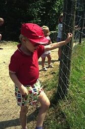{: width="168" height="256"}<!--[-->](../files/1992-08/loeffingen1.jpg)
* [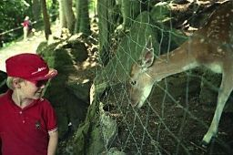{: width="256" height="170"}<!--[-->](../files/1992-08/loeffingen2.jpg)
* [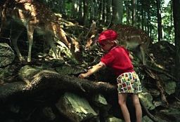{: width="256" height="174"}<!--[-->](../files/1992-08/loeffingen3.jpg)
* [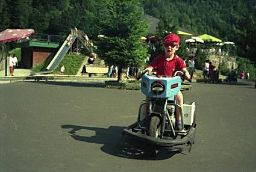{: width="256" height="172"}<!--[-->](../files/1992-08/loeffingen4.jpg)
* [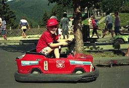{: width="256" height="175"}<!--[-->](../files/1992-08/loeffingen5.jpg)

Einen weiteren Ausflug unternehmen wir am 6. August nach Breitnau. Dort sind wir zunächst in der Glasbläserei, wo ich fasziniert zuschaue, wie verschiedene Glastiere entstehen und wir einen kleinen Glasfuchs kaufen. Anschließend geht es in die Ravennaschlucht.

{:.gallery}
* [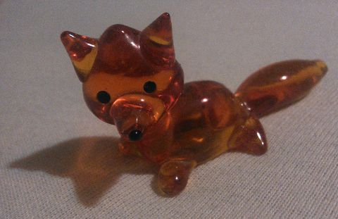{: width="480" height="311"}<!--[-->](../files/1992-08/fuchs.jpg)

In der nächsten Woche fahren wir am 11. August nach Sulzburg und am 12. August in die Wutachschlucht. Danach besuchen wir noch Oma und Opa für ein paar Tage, am 15. August sitzen wir auf der Terrasse und spielen Mix Max. Vermutlich bei diesem Besuch nähe ich mit Hilfe meiner Oma nach einer Anleitung auf einer Cornflakes-Schachtel eine Indianertasche für meinen Gürtel.

{:.gallery}
* [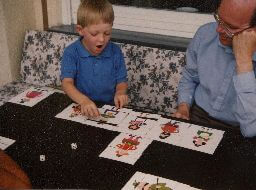{: width="256" height="190"}<!--[-->](../files/1992-08/mix-max.jpg)
* [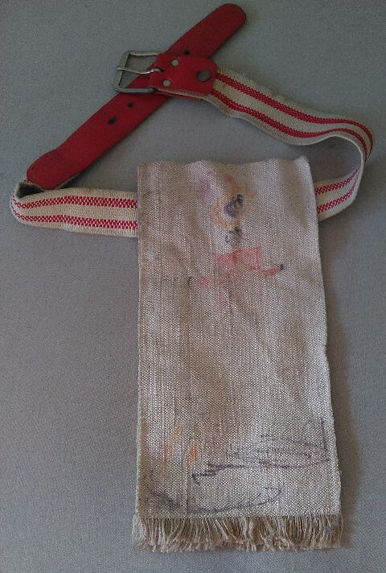{: width="480" height="712"}<!--[-->](../files/1992-08/indianertasche.jpg)

Aus ihrem Urlaub schreibt mir meine Tante eine Postkarte mit einem Rehkitz:

{:.letter}
> 
August 1992

>
> Dir, lieber Michael, 
> ein Extragruss!!!
>
> Gefällt Dir die Karte?
>
> Du kommst mich bald ’mal besuchen. 
> Deine Tante I.

Ob auch dieser Ausflug noch im August stattfindet, kann ich nicht sagen.

Daheim bastle ich. Was genau da entsteht, kann man auch im Großformat nicht erkennen, aber ich vermute, dass es ein Pappmodell der Arche Noah ist. Sehen – zumindest auf dem Originalfoto – kann man dafür, dass ich noch immer Probleme habe, eine Schere ordentlich zu halten. Klebeband mag ich übrigens auch nicht, mit einem Stück Tesa kann man mich jagen.

{:.gallery}
* [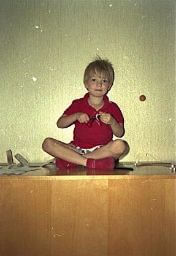{: width="176" height="256"}<!--[-->](../files/1992-08/basteln.jpg)

Einige weitere Fotos zeigen mich mit ein paar anderen Kindern auf einem Spielplatz. Wer diese Kinder sind, weiß ich ebenso wenig wie ich weiß, wo dieser Spielplatz ist, auch die Abzüge der Fotos sind nicht mehr aufzufinden.

{:.gallery}
* [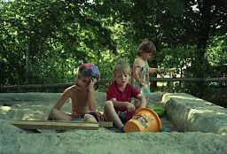{: width="256" height="174"}<!--[-->](../files/1992-08/spielplatz1.jpg)
* [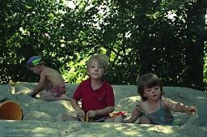{: width="256" height="169"}<!--[-->](../files/1992-08/spielplatz2.jpg)
* [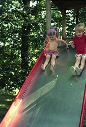{: width="174" height="256"}<!--[-->](../files/1992-08/spielplatz3.jpg)
* [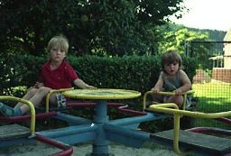{: width="256" height="173"}<!--[-->](../files/1992-08/spielplatz4.jpg)
* [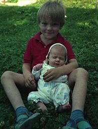{: width="195" height="256"}<!--[-->](../files/1992-08/spielplatz5.jpg)

Am 18. August beginnt der Kindergarten wieder, ich bin nun ein Vorschüler. In meinem letzten Jahr beginne ich dann auch im Kindergarten regelmäßig Bilder zu malen.

{:.image}
> [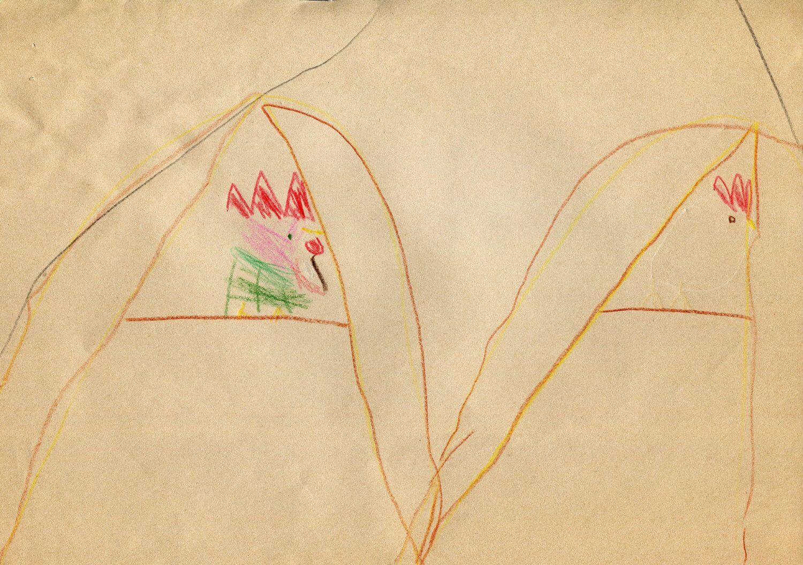{: width="1500" height="1056"}<!--[-->](../files/1992-08/hahn.jpg)

Außerdem bearbeiten wir im Kindergarten in diesem letzten Jahr zwei Hefte aus der Reihe <i>Spiele zum Lernen</i> von Mervi Miettinen und Tini Sauvo.

{:.gallery}
* [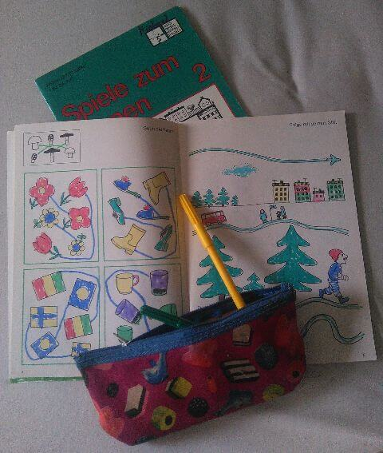{: width="480" height="567"}<!--[-->](../files/1992-08/spiele-zum-lernen.jpg)