## September 1992

<table class="month">
<tr><th>Mo</th><th>Di</th><th>Mi</th><th>Do</th><th>Fr</th><th class="h2">Sa</th><th class="h1">So</th></tr>
<tr><td></td><td>1</td><td>2</td><td>3</td><td>4</td><td class="h2">5</td><td class="h1">6</td></tr>
<tr><td>7</td><td>8</td><td>9</td><td>10</td><td>11</td><td class="h2">12</td><td class="h1">13</td></tr>
<tr><td>14</td><td>15</td><td>16</td><td>17</td><td>18</td><td class="h2">19</td><td class="h1">20</td></tr>
<tr><td>21</td><td>22</td><td>23</td><td>24</td><td>25</td><td class="h2">26</td><td class="h1">27</td></tr>
<tr><td>28</td><td>29</td><td>30</td><td></td><td></td><td></td><td></td></tr>
</table>

Der September beginnt mit einem Arztbesuch: Eigentlich war ja die U8 die letzte regelmäßige Untersuchung, aber inzwischen wurde eine neunte eingeführt. Dazu bin ich am 3. September bei einer neuen Kinderärztin. Ich messe inzwischen 1,12&nbsp;m und wiege 18,1&nbsp;kg. Die Ärztin stellt außerdem eine Phimose fest. Zunächst gibt es die Überlegung, diese zu operieren, letztendlich wird sie aber so behandelt, wie Phimosen üblicherweise behandelt werden: durch Abwarten.

Um diese Zeit herum besichtigen wir eine Mühle, wie die folgenden Fotos zeigen.

{:.gallery}
* [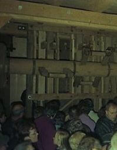{: width="199" height="256"}<!--[-->](../files/1992-09/muehle1.jpg)
* [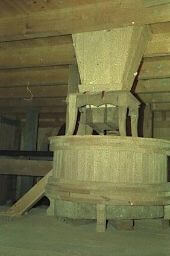{: width="170" height="256"}<!--[-->](../files/1992-09/muehle2.jpg)
* [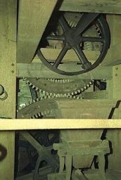{: width="172" height="256"}<!--[-->](../files/1992-09/muehle3.jpg)
* [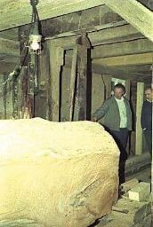{: width="172" height="256"}<!--[-->](../files/1992-09/muehle4.jpg)
* [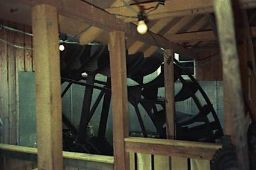{: width="256" height="170"}<!--[-->](../files/1992-09/muehle5.jpg)
* [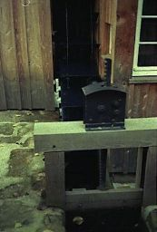{: width="173" height="256"}<!--[-->](../files/1992-09/muehle6.jpg)

Da mich solche Technik selbstverständlich fasziniert, leiht meine Mama bald darauf echte Fachliteratur aus der Bibliothek aus, unter anderem <i>Alte Bauernsägen im Schwarzwald und in den Alpenländern</i> und <i>Bauernmühlen im Schwarzwald</i> von Herbert Jüttemann. Die Zeichnungen in diesen Büchern sind so klar, dass man sie auch verstehen kann ohne lesen zu können, aber ich eigne mir aus diesen Büchern auch ein paar Fachbegriffe an, wie etwa „oberschlächtig“, „Rüttelschuh“ und – natürlich – „Kleiekotzer“.

Im Kindergarten basteln wir wieder, vermutlich diese Eule, die auf dem folgenden Bild schon nicht mehr in ihrem besten Zustand ist.

{:.gallery}
* [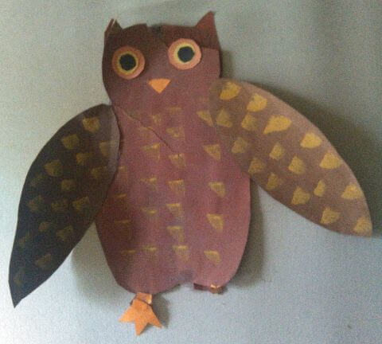{: width="480" height="432"}<!--[-->](../files/1992-09/eule.jpg)

Sie besteht aus farbigem Tonkarton, das Federkleid ist aufgestempelt und ursprünglich sitzt sie auf einem echten Zweig, der an ihren Füßen festgeklebt ist.

Es gibt auch wieder einige Bilder, die ich im Kindergarten – vielleicht um diese Zeit herum – gemalt habe, zum einen das folgende vom Froschkönig.

{:.gallery}
* [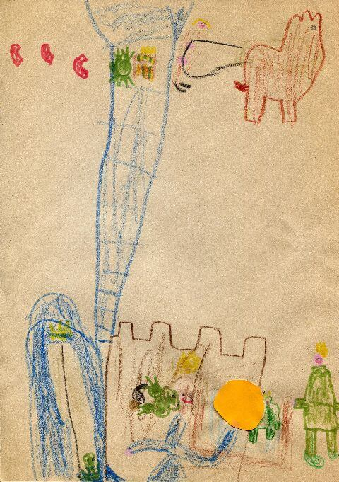{: width="480" height="681"}<!--[-->](../files/1992-09/froschkoenig.jpg)

Aber ich male nicht nur auf DIN-A-4-Format, für viele Bilder nutze ich lieber ein Kleinformat von ca. 10&nbsp;cm&nbsp;×&nbsp;15&nbsp;cm, etwa diese beiden Brände.

{:.gallery}
* [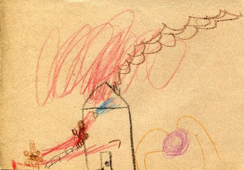{: width="480" height="334"}<!--[-->](../files/1992-09/brand1.jpg)
* [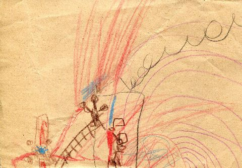{: width="480" height="334"}<!--[-->](../files/1992-09/brand2.jpg)

Daheim führe ich mit meinem Papa auf der Schreibmaschine eine Art Gespräch:

{:.gallery}
* [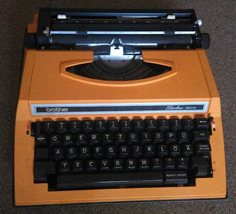{: width="480" height="435"}<!--[-->](../files/1992-09/schreibmaschine.jpg)

{: style="font-family: monospace; word-wrap: break-word;"}
> ATGVSDJOIUJHNBCXMKLPORIhAPUHGNGDCFHZUOKJMN?
>
> Michael du sollst nicht so viel schreien!!!
>
> 1TVIKL!
>
> Bald ist es Zeit ins Bett zu gehen.
>
> bEFIKO!
>
> Bald ist es Herbst.
>
> OJTI!
>
> Draussen wird es schon langsam dunkel.
>
> BST!
>
> Morgen ist Sonntag, und dann gibt es Kuchen, die Mama hat nämlich Apfelkuchen gebacken.
>
> KLUHDBUTWIOFJ.

Der Kuchen gehört bei uns jeden Sonntag zum Frühstück, ebenso – je nach Zeit im Jahr – die Radiosendung „Morgenläuten“ oder „Hafenkonzert – Gruß vom Bodensee“. Den Rest des Kuchens bekomme ich dann in den Folgetagen zum Abendessen und zum Frühstück. Samstags gibt es übrigens ein Ei zum Frühstück. Meine Eltern essen ihre Eier weich, ich mag meines lieber hartgekocht. Nur schälen kann ich es nicht selber, dazu ist es mir zu heiß.

{:.gallery}
* [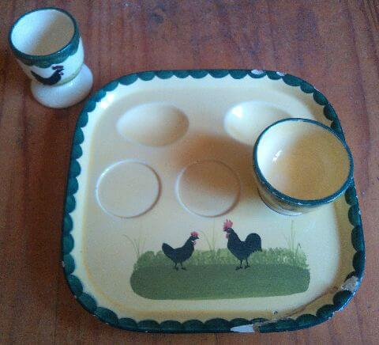{: width="480" height="436"}<!--[-->](../files/1992-09/hahn-henne.jpg)

  Platte für mein Ei, dahinter ein alternativer Eierbecher

Bei den Zügen, die regelmäßig am Fenster vorbeifahren, gibt es eine spannende Neuerung: die ersten ICEs.

Noch ein erstes Mal gibt es: Das erste Mal, dass ich mir selber etwas kaufe, nämlich ein Kinderüberraschungsei. Eigentlich wollte ich ja schon früher im Jahr eines kaufen, aber im Sommer gibt es keine, so musste ich bis zum Herbst warten. Was in dem Ei drinsteckt, kann ich nicht mehr feststellen in Anbetracht der Tatsache, dass ich aus dieser Saison mehr als zwei Dutzend Überraschungseier besitze, aber statistisch gesehen ist es am wahrscheinlichsten, dass es eines der doppelt vorhandenen Objekte ist.

{:.gallery}
* [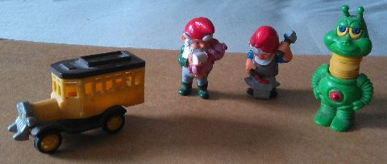{: width="480" height="204"}<!--[-->](../files/1992-09/eier.jpg)

Und schließlich schickt mir meine Oma zum Namenstag wie üblich eine Karte (inklusive der inzwischen ebenfalls üblichen Klage darüber, dass ich nicht telefoniere):

{:.letter}
> 
Zum 29. Sept. 92

>
> Lieber Michael!
>
> Wir grüßen Dich zu Deinem Namenstag und wünschen, daß Dein Schutzpatron, der heilige Erzengel Michael, immer seine Hand über Dich hält!
>
> Habt Ihr im Kindergarten schon geübt für das Erntedankfest am Sonntag? Erzähl’s mir mal am Telefon.
>
> Liebe Grüße auch an Deine Mama und an Deinen Papa 
> von Oma u. Opa
