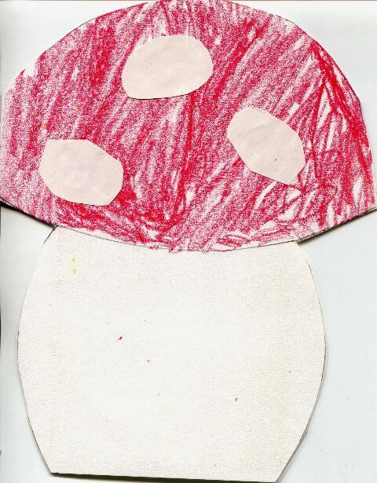
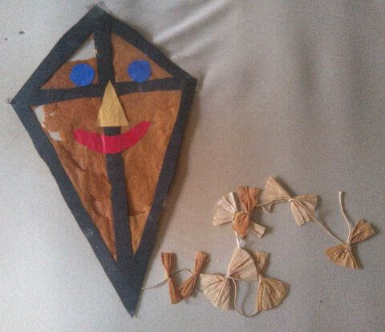
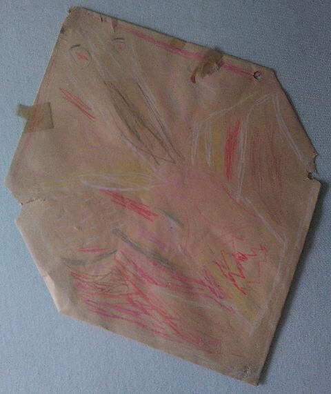
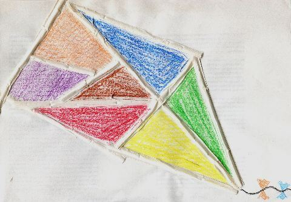
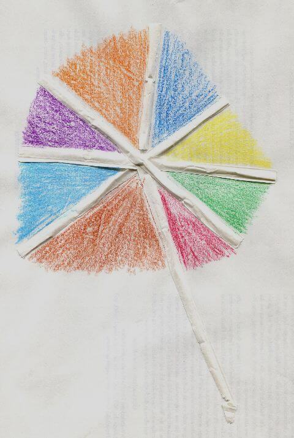
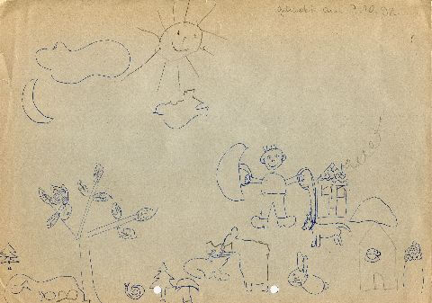
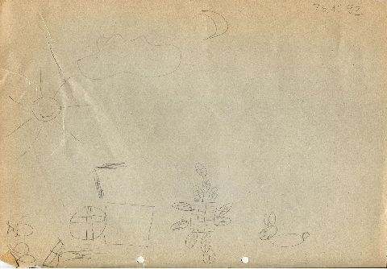
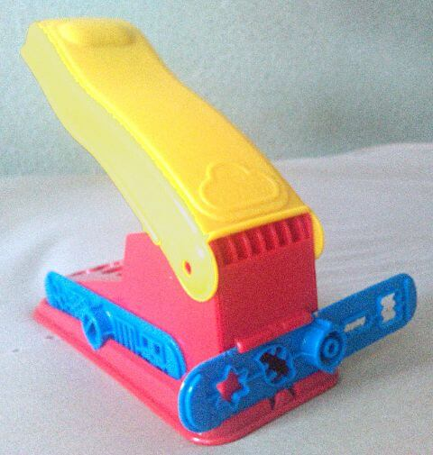

## Oktober 1992

<table class="month">
<tr><th>Mo</th><th>Di</th><th>Mi</th><th>Do</th><th>Fr</th><th class="h2">Sa</th><th class="h1">So</th></tr>
<tr><td></td><td></td><td></td><td>1</td><td>2</td><td class="h1">3</td><td class="h1">4</td></tr>
<tr><td>5</td><td>6</td><td>7</td><td>8</td><td>9</td><td class="h2">10</td><td class="h1">11</td></tr>
<tr><td>12</td><td>13</td><td>14</td><td>15</td><td>16</td><td class="h2">17</td><td class="h1">18</td></tr>
<tr><td>19</td><td>20</td><td>21</td><td>22</td><td>23</td><td class="h2">24</td><td class="h1">25</td></tr>
<tr><td>26</td><td>27</td><td>28</td><td>29</td><td>30</td><td class="h2">31</td><td></td></tr>
</table>

Wie meine Oma schon letzten Monat schrieb, gestalten wir wie schon im Vorjahr im Kindergarten den Erntedankgottesdienst am 4. Oktober mit. Wie üblich steckt die Einladung dazu in einer gebastelten Hülle, dieses Mal ist es ein Fliegenpilz (was auch immer der mit Erntedank zu tun hat).

{:.gallery}
* [{: width="480" height="615"}<!--[-->](../files/1992-10/einladung.jpg)

Im Kindergarten basteln wir auch einen Drachen aus Transparentpapier. Anschließend hängt er so lange an meinem Fenster, bis er ganz ausgeblichen und brüchig ist, sodass er auf dem Foto nicht mehr so hübsch wirkt, wie er ursprünglich einmal aussah. Ich hänge auch noch einen zweiten Drachen daneben, wesentlich schlichter gefaltet aus einem einfachen Blatt Papier.

{:.gallery}
* [{: width="480" height="415"}<!--[-->](../files/1992-10/drachen.jpg)
* [{: width="480" height="571"}<!--[-->](../files/1992-10/papierdrachen.jpg)

Noch einen dritten Drachen gestalte ich. Dieser ist gemalt mit aufgeklebten Papierstreifen, die das Bild zu einem Relief machen. In der gleichen Weise gestalte ich auch noch ein Windrad.

{:.gallery}
* [{: width="480" height="333"}<!--[-->](../files/1992-10/relief1.jpg)
* [{: width="480" height="714"}<!--[-->](../files/1992-10/relief2.jpg)

Außerdem forme ich wieder verschiedene Figuren aus Knete, die meine Mama wieder für mich aufmalt. Die Blätter sehen dabei ganz so aus, als seien sie mit dem Knetwerk entstanden, einer Presse für Knete mit verschiedenen Aufsätzen für unterschiedliche Formen, darunter eben auch Blätter. Gut möglich, dass ich sie zum Namenstag im letzten Monat geschenkt bekommen habe.

{:.gallery}
* [{: width="480" height="337"}<!--[-->](../files/1992-10/knete1.jpg)

  geknetet am 7. 10. 92
* [{: width="480" height="334"}<!--[-->](../files/1992-10/knete2.jpg)

  26\. 10. 92
* [{: width="480" height="505"}<!--[-->](../files/1992-10/knetwerk.jpg)